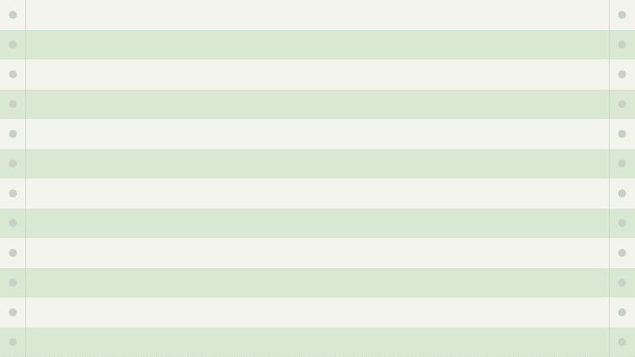
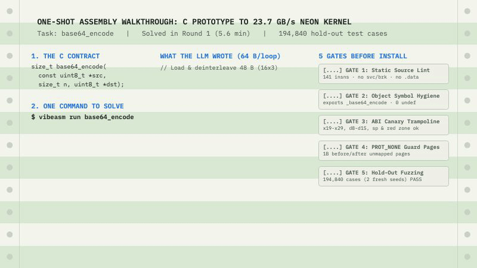
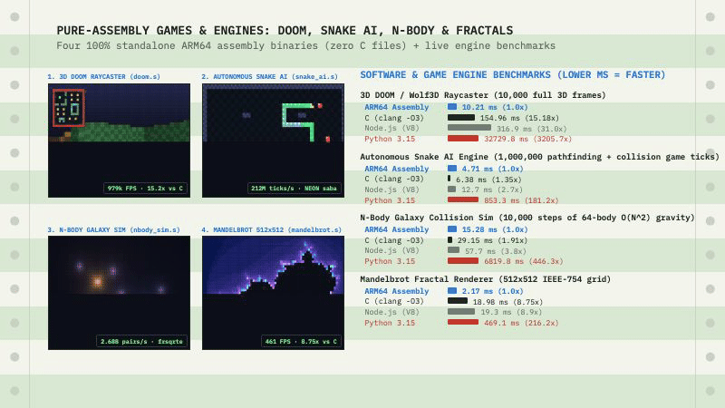
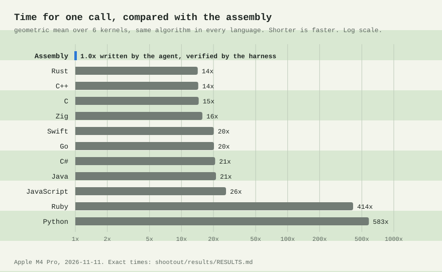
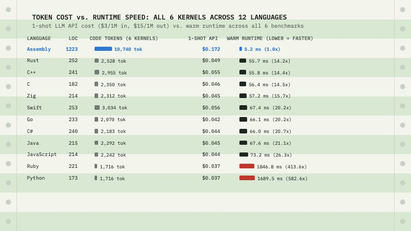
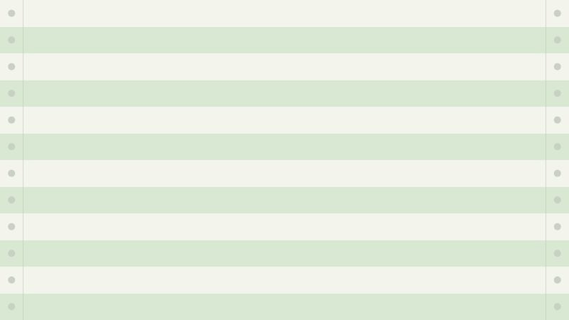

# vibe-assembly

[](https://github.com/bizzono/vibe-assembly/actions/workflows/ci.yml)
[](LICENSE)

**Let an agent write the assembly. Do not trust a line of it.**



Language models know the instruction set manuals cold—NEON permute tables, polynomial multiply instructions, carryless reductions, branchless bit tricks—and they will cheerfully hand you a routine with a subtle lane overflow at byte 16,177 or a clobbered callee-saved register on an early-exit branch.

`vibe-assembly` is a zero-dependency verification and benchmarking harness that puts an LLM agent in a tight feedback loop with an adversarial C/assembly referee:

1. **Five verification gates** stand between a candidate `.s` file and the benchmark timer: static source lint, object symbol hygiene, an assembly ABI trampoline that poisons caller-saved registers and checks every callee-saved register (plus red-zone and stack alignment), `mmap` guard pages on both ends of every input/output buffer, and differential fuzzing across hundreds of thousands of inputs.
2. **Hold-out seeds** keep the agent honest: the seeds used while the agent iterates inside `vibeasm check` are never the seeds used by the round judge (`vibeasm run`), and a winning candidate must pass a final full verification pass with fresh seeds before it can enter `solutions/`.
3. **Head-to-head timing** measures the verified assembly against `clang -O3 -mcpu=native` across the task's size sweep, and `shootout/` times the exact same six kernels across **12 languages** under a single protocol.

---

## Verified results (`arm64-darwin`, Apple M4 Pro)

Every solution in [`solutions/arm64-darwin/`](solutions/arm64-darwin/) was accepted by the harness against `clang -O3 -mcpu=native` (`Apple clang 21.0.0`):

| Task | Kernel | vs `clang -O3 -mcpu=native` | Largest case | Hold-out test cases | Instructions | Technique |
|---|---|---:|---:|---:|---:|---|
| [`crc32`](tasks/crc32/SPEC.md) | IEEE 802.3 CRC-32 | **88.06x** | 199.8x (1 MiB) | 194,820 | 450 | 12-way `pmull`/`pmull2` folding + `crc32cb`/`crc32cx` |
| [`wordcount`](tasks/wordcount/SPEC.md) | ASCII whitespace word count | **20.55x** | 25.7x (4 MiB) | 266,383 | 135 | NEON `tbl` whitespace bitmap + `saba` 255-chunk accumulator |
| [`utf8_validate`](tasks/utf8_validate/SPEC.md) | RFC 3629 UTF-8 validation | **11.77x** | 39.5x (1 MiB) | 302,144 | 275 | Keiser–Lemire 3-table NEON `tbl` DFA + ASCII fast path |
| [`mandelbrot`](tasks/mandelbrot/SPEC.md) | Escape-time Mandelbrot sum | **6.71x** | 8.7x (512×512) | 6,000 | 142 | `float64x2_t` 2-row×2-col unroll + cardioid/bulb rejection |
| [`base64_encode`](tasks/base64_encode/SPEC.md) | RFC 4648 Base64 encode | **4.79x** | 5.8x (1 MiB) | 194,840 | 141 | `ld3` deinterleave + 6-bit split + 64-byte `tbl` alphabet lookup |
| [`nqueens`](tasks/nqueens/SPEC.md) | Exact $N$-Queens count | **2.12x** | 2.5x ($N=10$) | 2,400 | 191 | Half-board symmetry + 2-level unroll + register-resident DFS |

Provenance records (exact per-case timings, SHA-256 hashes, verification seeds, and agent metadata) sit next to each `.s` file in [`solutions/arm64-darwin/`](solutions/arm64-darwin/).

---

## One-shot walkthrough & visual application examples

Can you write an entire application—or replace the hot path of an existing one—with straight assembly produced in a single shot? Yes, because every verified `.s` file in [`solutions/arm64-darwin/`](solutions/arm64-darwin/) is a standard Mach-O object obeying the C calling convention, and you can also write standalone `_main` binaries in 100% assembly.

### 1. Anatomy of a one-shot solution (`base64_encode` in 1 round)



Given only the 3-line C prototype in [`tasks/base64_encode/SPEC.md`](tasks/base64_encode/SPEC.md), a single round of `bin/vibeasm run base64_encode` produced [`solutions/arm64-darwin/base64_encode.s`](solutions/arm64-darwin/base64_encode.s) (141 instructions, **4.79x** geomean, **5.84x** at 1 MiB = **23.7 GB/s**):

```armasm
// Load 48 input bytes and de-interleave every 3-byte group into v0, v1, v2:
ld3     {v0.16b, v1.16b, v2.16b}, [x0], #48

// Split each 24-bit triple (a, b, c) into four 6-bit indices (0..63):
ushr    v3.16b, v0.16b, #2          // idx0 = a >> 2
ushr    v4.16b, v1.16b, #4
sli     v4.16b, v0.16b, #4          // idx1 = ((a & 3) << 4) | (b >> 4)
and     v4.16b, v4.16b, v20.16b     // mask to 0x3f
ushr    v5.16b, v2.16b, #6
sli     v5.16b, v1.16b, #2          // idx2 = ((b & 0xf) << 2) | (c >> 6)
and     v5.16b, v5.16b, v20.16b
and     v6.16b, v2.16b, v20.16b     // idx3 = c & 0x3f

// Translate all 64 indices through the 64-byte Base64 alphabet in v16..v19:
tbl     v3.16b, {v16.16b, v17.16b, v18.16b, v19.16b}, v3.16b
tbl     v4.16b, {v16.16b, v17.16b, v18.16b, v19.16b}, v4.16b
tbl     v5.16b, {v16.16b, v17.16b, v18.16b, v19.16b}, v5.16b
tbl     v6.16b, {v16.16b, v17.16b, v18.16b, v19.16b}, v6.16b

// Interleave the four 16-byte vectors and store 64 Base64 characters at once:
st4     {v3.16b, v4.16b, v5.16b, v6.16b}, [x2], #64
```

### 2. Visual example: a 100% standalone assembly application (zero C files)

[`examples/standalone_mandelbrot.s`](examples/standalone_mandelbrot.s) is a complete macOS executable written **entirely in ARM64 assembly**—no `.c` files, no `printf`, no third-party libraries. It computes a 72×48 IEEE-754 double-precision Mandelbrot grid with analytical cardioid and period-2 bulb rejection, formats 24-bit truecolor ANSI half-blocks (`▀`) on the stack, and flushes the frame in a single `_write` system call:

```sh
clang examples/standalone_mandelbrot.s -o /tmp/mandelbrot && /tmp/mandelbrot
```


### 3. Pure-assembly games & simulation engines: DOOM 3D Raycaster, Snake AI & N-Body Physics

Beyond library kernels, [`examples/`](examples/) includes **four complete, zero-C-file applications and game engines** written in 100% ARM64 assembly—each rendering a 72×48 24-bit truecolor ANSI framebuffer in a single `_write` syscall and including a built-in `--bench` mode to time raw engine throughput against `clang -O3`, Node.js (V8 JIT), and Python:



```sh
# 1. 3D DOOM / Wolfenstein DDA Raycaster + Mini-Map + Torch Lighting (zero C files)
clang examples/doom_raycaster.s -o /tmp/doom && /tmp/doom

# 2. Autonomous Arcade Snake Game + NEON Pathfinding AI (zero C files)
clang examples/snake_ai.s -o /tmp/snake && /tmp/snake

# 3. N-Body Galaxy Collision & Gravitational Potential Sim (zero C files)
clang examples/nbody_sim.s -o /tmp/nbody && /tmp/nbody

# 4. Run raw engine benchmarks (--bench)
/tmp/doom --bench && /tmp/snake --bench && /tmp/nbody --bench
```

| Software / Game Engine Workload | Pure ARM64 Assembly (`.s`) | C (`clang -O3`) | Node.js (V8 JIT) | Python 3.15 | Assembly Speedup vs C / Python | Key Assembly Technique |
|---|---:|---:|---:|---:|---:|---|
| **3D DOOM / Wolf3D Raycaster** (`10,000` full 72×48 3D frames) | **10.21 ms** (`979,432 FPS`) | 154.96 ms (15.2x) | 316.9 ms (31.0x) | 32,729.8 ms (3,205.7x) | **15.2x vs C · 3,206x vs Python** | Per-column DDA raycast + NEON 4-row `cmgt`/`addv` SIMD vertical column shader |
| **Autonomous Snake AI Engine** (`1,000,000` pathfinding + collision ticks) | **4.71 ms** (`212.3M ticks/s`) | 6.38 ms (1.35x) | 12.7 ms (2.7x) | 853.3 ms (181.2x) | **1.35x vs C · 181x vs Python** | NEON `sabd.4s` + `saba.4s` 4-direction Manhattan distance + `uminv` 1-cycle min |
| **N-Body Galaxy Gravity Sim** (`10,000` steps of 64-body $O(N^2)$ = `40.96M` pairs) | **15.28 ms** (`2.68B pairs/s`) | 29.15 ms (1.91x) | 57.7 ms (3.8x) | 6,819.8 ms (446.3x) | **1.91x vs C · 446x vs Python** | SoA layout + NEON 4-wide `frsqrte.4s` reciprocal square root + 2-body outer unroll |
| **Mandelbrot 512×512 Renderer** (`262,144` pixels @ 200 max iterations) | **2.17 ms** (`460.8 FPS`) | 18.98 ms (8.75x) | 19.3 ms (8.9x) | 469.1 ms (216.2x) | **8.75x vs C · 216x vs Python** | `float64x2_t` 2×2 unroll + analytical cardioid & period-2 bulb skip |

### 4. Drop-in C/C++/CMake/Make SDK integration (`include/vibeasm.h`)

To embed all 6 verified kernels as a static (`libvibeasm.a`) or shared (`libvibeasm.dylib` / `libvibeasm.so`) library in a C, C++, Rust, or Zig application, include [`include/vibeasm.h`](include/vibeasm.h) and build with `make` or `cmake` (which automatically link `solutions/<target>/*.s` when available and fall back to `tasks/*/ref.c` on other platforms):

```sh
# Build static + shared libraries and run the demo CLI (examples/fast_cli.c)
make all && ./build/vibe-demo

# Or build and test with CMake
cmake -B build && cmake --build build && ctest --test-dir build --output-on-failure

# Or link the .s files directly in a single compiler invocation
clang -O3 -Iinclude examples/fast_cli.c solutions/arm64-darwin/*.s -o /tmp/vibe-demo && /tmp/vibe-demo
```

```
======================================================================
  vibe-assembly: calling verified arm64-darwin assembly from C
======================================================================

  1. utf8_validate (8 MiB) : valid=1          in  0.155 ms ( 54.1 GB/s)
  2. wordcount     (8 MiB) : 1094167 words   in  0.135 ms ( 62.1 GB/s)
  3. crc32_ieee    (8 MiB) : 0xcba9505c       in  0.085 ms ( 98.7 GB/s)
  4. base64_encode (6 MiB) : 8388608 chars   in  0.685 ms (  9.2 GB/s)
  5. mandelbrot  (512x512) : 9985499 iters   in  2.268 ms
  6. nqueens        (N=12) :   14200 boards  in  2.567 ms
```

---

## 12-language shootout

The same six kernels implemented idioms-first across 12 languages and timed on the same machine under [`shootout/PROTOCOL.md`](shootout/PROTOCOL.md) (minimum per-call time after warm-up; lower is better; multiplier is relative to Assembly):



| Language | Word count (8 MiB) | UTF-8 validate (8 MiB) | CRC-32 (8 MiB) | Base64 encode (6 MiB) | Mandelbrot (512×512) | N-queens ($N=12$) | Geomean vs asm |
|---|---:|---:|---:|---:|---:|---:|---:|
| **Assembly** | **120 us** | **366 us** | **76 us** | **257 us** | **2.17 ms** | **2.26 ms** | **1.0x** |
| **Rust** | 1.56 ms (13.0x) | 14.55 ms (39.7x) | 15.77 ms (208.1x) | 1.46 ms (5.7x) | 18.84 ms (8.7x) | 3.53 ms (1.6x) | **14.2x** |
| **C++** | 1.59 ms (13.2x) | 14.48 ms (39.5x) | 15.76 ms (207.9x) | 1.50 ms (5.8x) | 18.88 ms (8.7x) | 3.63 ms (1.6x) | **14.4x** |
| **C** | 1.61 ms (13.4x) | 15.18 ms (41.4x) | 15.50 ms (204.6x) | 1.50 ms (5.8x) | 18.98 ms (8.8x) | 3.64 ms (1.6x) | **14.5x** |
| **Zig** | 2.62 ms (21.8x) | 15.31 ms (41.8x) | 15.72 ms (207.4x) | 1.51 ms (5.9x) | 18.41 ms (8.5x) | 3.62 ms (1.6x) | **15.7x** |
| **Swift** | 9.83 ms (81.8x) | 15.44 ms (42.1x) | 17.83 ms (235.2x) | 1.50 ms (5.9x) | 19.23 ms (8.9x) | 3.59 ms (1.6x) | **20.2x** |
| **Go** | 9.25 ms (77.0x) | 15.40 ms (42.0x) | 16.85 ms (222.4x) | 1.57 ms (6.1x) | 18.97 ms (8.8x) | 4.01 ms (1.8x) | **20.2x** |
| **C#** | 8.62 ms (71.7x) | 15.37 ms (41.9x) | 16.99 ms (224.2x) | 2.19 ms (8.5x) | 19.36 ms (8.9x) | 3.50 ms (1.5x) | **20.7x** |
| **Java** | 9.12 ms (76.0x) | 17.07 ms (46.6x) | 17.93 ms (236.6x) | 2.08 ms (8.1x) | 17.81 ms (8.2x) | 3.60 ms (1.6x) | **21.1x** |
| **JavaScript** | 11.04 ms (92.0x) | 17.70 ms (48.3x) | 14.85 ms (195.9x) | 3.85 ms (15.0x) | 19.30 ms (8.9x) | 6.41 ms (2.8x) | **26.3x** |
| **Ruby** | 133 ms (1109.3x) | 342 ms (932.2x) | 135 ms (1782.7x) | 370 ms (1440.7x) | 856 ms (395.4x) | 10.77 ms (4.8x) | **413.6x** |
| **Python** | 137 ms (1137.3x) | 139 ms (380.4x) | 451 ms (5950.3x) | 389 ms (1515.0x) | 469 ms (216.6x) | 105 ms (46.3x) | **582.6x** |

Full cold-start and warm-loop tables, toolchain versions, and methodology are in [`shootout/results/RESULTS.md`](shootout/results/RESULTS.md) and [`shootout/PROTOCOL.md`](shootout/PROTOCOL.md).

---

## Token cost & code footprint across all 12 languages vs. Assembly

How many LLM tokens does it actually cost to write all six kernels in assembly compared to high-level languages—and what do those tokens buy in runtime performance?

Measured directly across all 72 source files in [`solutions/arm64-darwin/`](solutions/arm64-darwin/) and [`shootout/langs/`](shootout/langs/) via [`shootout/tokens.py`](shootout/tokens.py):



| Language | Total LOC (6 kernels) | Source Bytes | Code Tokens (6 kernels) | 1-Shot LLM Cost ($3/$15 per 1M) | Full Agentic Loop Cost | Batch Runtime (all 6 kernels) | Geomean vs Assembly |
|---|---:|---:|---:|---:|---:|---:|---:|
| **Assembly** | **1,223** | **36,585 B** | **10,740** | **$0.172** | **$14.52** | **5.2 ms** | **1.0x** |
| **Rust** | 252 | 8,541 B | 2,528 | $0.049 | — | 55.7 ms | **14.2x** |
| **C++** | 241 | 9,620 B | 2,955 | $0.055 | — | 55.8 ms | **14.4x** |
| **C** | 182 | 8,725 B | 2,350 | $0.046 | — | 56.4 ms | **14.5x** |
| **Zig** | 214 | 7,246 B | 2,312 | $0.045 | — | 57.2 ms | **15.7x** |
| **Swift** | 253 | 11,425 B | 3,034 | $0.056 | — | 67.4 ms | **20.2x** |
| **Go** | 233 | 6,216 B | 2,070 | $0.042 | — | 66.1 ms | **20.2x** |
| **C#** | 240 | 8,305 B | 2,183 | $0.044 | — | 66.0 ms | **20.7x** |
| **Java** | 215 | 8,067 B | 2,292 | $0.045 | — | 67.6 ms | **21.1x** |
| **JavaScript** | 214 | 6,811 B | 2,242 | $0.044 | — | 73.2 ms | **26.3x** |
| **Ruby** | 221 | 6,329 B | 1,716 | $0.037 | — | 1,846.8 ms | **413.6x** |
| **Python** | 173 | 6,292 B | 1,716 | $0.037 | — | 1,689.5 ms | **582.6x** |

### Per-task code tokens & verified agent cost breakdown

| Language | `wordcount` | `utf8_validate` | `crc32` | `base64_encode` | `mandelbrot` | `nqueens` | Total Tokens |
|---|---:|---:|---:|---:|---:|---:|---:|
| **Assembly** | 1,291 ($2.55) | 2,195 ($4.80) | 2,589 ($3.24) | 1,644 ($1.33) | 1,350 ($2.60) | 1,671 (manual) | **10,740** |
| **C** | 167 | 462 | 893 | 404 | 235 | 189 | **2,350** |
| **C++** | 218 | 557 | 345 | 826 | 586 | 423 | **2,955** |
| **Rust** | 254 | 530 | 297 | 738 | 415 | 294 | **2,528** |
| **Zig** | 166 | 498 | 256 | 628 | 467 | 297 | **2,312** |
| **Go** | 146 | 464 | 239 | 585 | 398 | 238 | **2,070** |
| **Swift** | 182 | 487 | 994 | 663 | 423 | 285 | **3,034** |
| **Java** | 191 | 501 | 251 | 616 | 426 | 307 | **2,292** |
| **C#** | 159 | 489 | 234 | 686 | 358 | 257 | **2,183** |
| **JavaScript** | 164 | 465 | 273 | 683 | 367 | 290 | **2,242** |
| **Python** | 97 | 420 | 189 | 452 | 295 | 263 | **1,716** |
| **Ruby** | 102 | 415 | 174 | 498 | 264 | 263 | **1,716** |

Key takeaways:
- **~4.6x code tokens for a 14.5x–582.6x runtime speedup**: Across all 6 kernels, the verified assembly is **10,740 code tokens** vs **2,350** in C, **2,528** in Rust, and **1,716** in Python/Ruby.
- **+$0.13 in one-shot output tokens**: In a single-shot prompt ($3/1M input, $15/1M output), generating all 6 kernels in assembly costs **$0.172** vs **$0.037–$0.056** in high-level languages—a delta of **13 cents**.
- **$14.52 for full autonomous multi-turn verification**: Running the multi-round agentic harness (`vibeasm run`, where the agent iteratively writes candidates, runs `vibeasm check` and `vibeasm bench`, diagnoses counterexamples, and clears over 1,000,000 hold-out fuzz cases) cost **$1.33 to $4.80 per kernel** (**$14.52 total**).

---

## Why the gates matter: a real catch



During the first autonomous run on `wordcount` ([`docs/logs/wordcount-first-run.log`](docs/logs/wordcount-first-run.log)), the agent wrote a NEON routine that classified 64 bytes per iteration and accumulated per-lane word-start counts in unsigned byte lanes (`v24.16b`), flushing them to 64-bit integers every 255 iterations.

It was **20.61x** faster than `clang -O3`. It passed all 23,112 quick-check test cases in round 1.

Then the harness ran final verification with fresh hold-out seeds and rejected it before installation:

```
final verification of the winner (new seeds) before installing...
the best candidate failed final verification: wrong result on test case #11499
```

Why did it fail at length 16,177?
- $255 \text{ iterations} \times 64 \text{ bytes} = 16{,}320 \text{ bytes}$.
- Each iteration could add up to 4 to a byte lane (`saba`), so a lane could overflow 255 after just $\lfloor 255 / 4 \rfloor = 63$ iterations ($4{,}032$ bytes) of dense alternating words.
- Even when flushing every 63 iterations, the initial `sub v24.16b, v24.16b, v16.16b` seeded each lane with `1` (`-1 == +1`), so $1 + 63 \times 4 = 253$, plus the loop tail's extra 4 overflowed `257 -> 1` on inputs of dense `a a a a ...` right around 16 KiB.

Because the harness dumped the failing input and handed the counterexample back to round 2, the agent diagnosed the exact byte-lane saturation math with `vibeasm call --gen 16177 --flavor 4`, reduced the inner batch limit to 62 iterations, and passed all **266,383** hold-out test cases at **20.55x**.

Every bug class the harness is built to catch—callee-saved register clobbers, stack misalignment, red-zone scribbles, one-byte buffer overreads, one-byte buffer overwrites, sign-extended length bugs, and SIMD lane overflows—has a dedicated regression test in [`tests/zoo/`](tests/zoo/).

---

## How the five gates work

Every candidate `.s` file must clear five gates in order (see [`docs/HOW_IT_WORKS.md`](docs/HOW_IT_WORKS.md) for the full design):

1. **Source lint (`vibeasm/lint.py`)**: Rejects forbidden instructions (`svc`, `brk`, `hlt`), external calls (`bl`/`blr` to symbols outside the file), mutable data sections (`.data`, `.bss`, `.comm`), and hardcoded task answers.
2. **Object symbol check (`nm`)**: Assembles the candidate and inspects the object file with `nm` to ensure it defines the task symbol and has zero undefined (`U`) symbols.
3. **ABI & register-file trampoline (`vibeasm/kit/tramp_arm64_darwin.s`)**: Wraps every call to the candidate function:
   - Snapshots callee-saved registers `x19`–`x29`, `sp`, and `d8`–`d15`.
   - Poisons caller-saved general and NEON registers (`x6`–`x17`, `v0`–`v7`, `v16`–`v31`) with a deterministic canary pattern so uninitialized register reads fail immediately.
   - Paints 128 bytes below `sp` and verifies the candidate leaves `sp`, `x19`–`x29`, and the lower 64 bits of `v8`–`v15` bit-for-bit intact.
4. **Page-guarded memory arenas (`vibeasm/kit/driver.c`)**: Places every input buffer and output buffer in a two-page `mmap` region with `PROT_NONE` guard pages before and after, testing both right-aligned (one byte before the trailing unmapped page) and left-aligned (one byte after the leading unmapped page) placements, plus canary bytes around outputs.
5. **Differential fuzzing (`ref.c` + `gen.c`)**: Compares the candidate's return value and output buffer against the C reference implementation across edge cases (length 0, 1, 15, 16, 17, 31, 32, 63, 64, 4095, 4096, ...) and thousands of pseudorandom inputs across every task flavor and alignment offset `0..15`.

---

## Quick start

Requirements: macOS on Apple Silicon (`arm64-darwin`), Python 3.9+ (standard library only), and the Xcode Command Line Tools (`clang`, `nm`, `otool`).

```sh
# 1. Check your local toolchain
bin/vibeasm doctor

# 2. List all tasks and their installed scores
bin/vibeasm list

# 3. Re-verify and re-time every installed solution in solutions/
bin/vibeasm verify --quick
```

### Interactive workflow (for an agent or human in a work directory)

```sh
# Set up runs/<task>/manual/work with TASK.md, ABI.md, ref.c, baseline.s, solution.s
bin/vibeasm work wordcount

# Inside the work directory, assemble + run all 5 verification gates
bin/vibeasm check wordcount runs/wordcount/manual/work/solution.s

# Probe a single input (literal text, hex, file, or generator size/flavor)
bin/vibeasm call wordcount runs/wordcount/manual/work/solution.s --text "hello world"
bin/vibeasm call wordcount runs/wordcount/manual/work/solution.s --gen 16177 --flavor 4

# Verify and benchmark side-by-side against clang -O3 -mcpu=native
bin/vibeasm bench wordcount runs/wordcount/manual/work/solution.s

# Run full hold-out verification + 101-sample timing and install into solutions/
bin/vibeasm accept wordcount runs/wordcount/manual/work/solution.s
```

### Autonomous multi-round agent loop

```sh
# Run a headless Claude Code agent (confined to the work directory) for up to 4 rounds
bin/vibeasm run wordcount --rounds 4

# Or use any command-line model/agent script that reads TASK.md on stdin
bin/vibeasm run wordcount --agent cmd --agent-cmd "my-agent-wrapper"
```

---

## Running the test suite and shootout

```sh
# Run the harness's own test suite (zoo regression tests, ABI checks, round-loop recovery)
python3 -m unittest discover -s tests -v

# Smoke-test all 12 languages x 6 kernels in the shootout
python3 shootout/shootout.py --quick --no-write

# Run the full 12-language shootout and regenerate the SVG chart
python3 shootout/shootout.py
python3 shootout/chart.py
```

---

## Supported targets

| Target | ISA & ABI | Baseline CPU Features | Status |
|---|---|---|---|
| `arm64-darwin` | AArch64 Mach-O (Apple AAPCS64) | Apple M1+ (ARMv8.4-A, NEON, CRC32, AES/PMULL, DotProd, SHA3) | **Supported & all 6 tasks solved** |
| `arm64-linux` | AArch64 ELF (AAPCS64) | ARMv8.2-A+ (NEON, CRC32, AES/PMULL, DotProd, FP16, LSE) | **Supported in harness & CI** |
| `x86_64-linux` | x86-64 ELF (System V AMD64) | `x86-64-v3` (AVX2, BMI1/2, FMA, LZCNT, POPCNT, PCLMULQDQ) | **Supported in harness & CI** |

---

## Repository layout

- [`bin/vibeasm`](bin/vibeasm) & [`vibeasm/`](vibeasm/) — CLI and verification/benchmarking harness (Python 3.9+, zero third-party packages).
- [`include/vibeasm.h`](include/vibeasm.h), [`Makefile`](Makefile), [`CMakeLists.txt`](CMakeLists.txt) — Public C/C++ SDK header and static/shared library build definitions (`libvibeasm.a`, `libvibeasm.dylib`/`.so`).
- [`vibeasm/kit/`](vibeasm/kit/) — C test/benchmark driver ([`driver.c`](vibeasm/kit/driver.c)) and ABI check trampolines ([`tramp_arm64_darwin.s`](vibeasm/kit/tramp_arm64_darwin.s), [`tramp_arm64_linux.s`](vibeasm/kit/tramp_arm64_linux.s), [`tramp_x86_64_linux.s`](vibeasm/kit/tramp_x86_64_linux.s)).
- [`tasks/`](tasks/) — Task specifications (`SPEC.md`), reference implementations (`ref.c`), input generators (`gen.c`), and benchmark configurations (`task.json`).
- [`solutions/arm64-darwin/`](solutions/arm64-darwin/) — Verified assembly solutions (`.s`) and their provenance records (`.json`).
- [`examples/`](examples/) — Runnable standalone ARM64 assembly binary ([`standalone_mandelbrot.s`](examples/standalone_mandelbrot.s)), C application linking all 6 verified `.s` kernels ([`fast_cli.c`](examples/fast_cli.c)), and visual SVG generator ([`make_visuals.py`](examples/make_visuals.py)).
- [`shootout/`](shootout/) — 12-language benchmark suite (`c`, `asm`, `cpp`, `rust`, `zig`, `go`, `swift`, `java`, `csharp`, `js`, `python`, `ruby`), runner ([`shootout.py`](shootout/shootout.py)), chart generator ([`chart.py`](shootout/chart.py)), and results ([`RESULTS.md`](shootout/results/RESULTS.md)).
- [`tests/`](tests/) — Harness unit tests ([`test_harness.py`](tests/test_harness.py)) and the [`tests/zoo/`](tests/zoo/) gallery of buggy assembly files that each fail one specific gate.
- [`video/`](video/) — Remotion project that renders the green-bar line-printer preview from [`video/src/data.json`](video/src/data.json).
- **Documentation & Governance**:
  - [`docs/HOW_IT_WORKS.md`](docs/HOW_IT_WORKS.md) — Architecture of the verification gates, trampoline, and round loop.
  - [`docs/WRITING_A_TASK.md`](docs/WRITING_A_TASK.md) — How to add a new assembly task (`bin/vibeasm new`).
  - [`docs/ADDING_A_TARGET.md`](docs/ADDING_A_TARGET.md) — How to add a new architecture/OS target.
  - [`shootout/PROTOCOL.md`](shootout/PROTOCOL.md) — Rules and measurement protocol for the 12-language shootout.
  - [`SECURITY.md`](SECURITY.md) — Security policy, verification threat model, and agent sandboxing.
  - [`CONTRIBUTING.md`](CONTRIBUTING.md) — Contribution rules, gate invariants, and PR checklist.
  - [`CHANGELOG.md`](CHANGELOG.md) — Release history.
